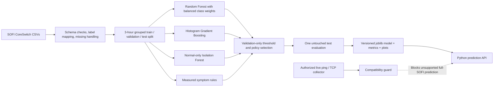

# NetSentinel Intelligent Fault Intelligence Engine

This workspace originally contained a Tkinter monitoring prototype and no ML dataset, notebook, or trained model. The updated project keeps the authorized live collector but makes the ML engine an independent, reusable package. The GUI is optional; all training and prediction commands run from Python without a UI.

## Dataset and scientific scope

The selected benchmark is SOFI, a public IP-network fault-diagnosis dataset (Mendeley Data v2, DOI `10.17632/tc6ysmh5j8.2`, CC BY 4.0). Its labels are binary: `NE` (healthy) and `F` (faulty). It describes monitored performance from an emulated enterprise network with induced link/fault scenarios. The benchmark does **not** label the specific fault cause; predictions must not be presented as root-cause identification. It is a network performance/fault dataset, not an intrusion-detection dataset.

The provider page reports 12,971 instances, about 649 monitoring hours, and around 10 hours with induced faults; it lists separate CoreSwitch-I and CoreSwitch-II CSV files. The actual row counts, schema, duplicate count, class balance, and missing values are computed from the supplied files at training time. The two processed CSV files are now present in `data/raw/`; the loader normalizes case-only differences in their column names.

## Architecture



- **Supervised candidates:** Random Forest (`balanced_subsample`) and HistGradientBoosting (`balanced`). Numeric inputs use median imputation with missingness indicators; categorical inputs use most-frequent imputation and one-hot encoding. The fitted pipeline is serialized with exact feature order.
- **Anomaly component:** Isolation Forest is trained on training-partition `NE` rows only. Its anomaly score is `-score_samples` (higher means more unusual); the initial threshold is the 99th percentile of the training-normal score distribution. Held-out false-alarm rate and detection metrics are reported.
- **Rule layer:** transparent symptom checks for unavailable ICMP/SNMP and very high measured ICMP loss, when those columns exist. A symptom does not prove its cause.
- **Model selection:** classifier and operating strategy are selected using validation only. The report compares supervised, Isolation Forest, rules, and their union. It does not assume the union is best. The holdout test is scored once after selection.
- **Leakage controls:** time/timestamp and device identifiers are excluded as model features. All rows in the same three-hour time block stay in one partition; exact fully repeated records are removed, but repeated values at different timestamps remain. The split seed and partition sizes are saved. This is a blocked random time-window split, not a claim of future-proof generalization.
- **Explainability:** validation-set permutation importance is saved and described as global association, not causation or per-record proof.

## Install and run

Python 3.10+ is required. Install project dependencies (scikit-learn 1.5+ recommended):

```powershell
python -m pip install -r requirements.txt
```

After placing the SOFI CSVs in `data/raw/`, run from this `outputs` folder:

```powershell
python -m ml.train --data-dir data/raw
```

The command writes `models/sofi_hybrid_fault_model_v1.joblib` plus reports under `reports/sofi_experiment/`. Training completed on the supplied files. The selected classifier was `random_forest_leaf2` with the supervised strategy. Held-out metrics: accuracy 0.9906, fault precision 0.4000, fault recall 0.3333, fault F1 0.3636, macro-F1 0.6795, false-positive rate 0.0040, false-negative rate 0.6667, ROC-AUC 0.8801, and PR-AUC 0.2726. Confusion matrix: `[[5176, 21], [28, 14]]`. Accuracy is dominated by the normal class; report the low fault recall prominently. These results are for the held-out benchmark time blocks and do not establish live-network performance.

Direct inference from Python:

```python
from ml.predict import predict_network_fault
result = predict_network_fault(one_sofi_feature_row)
print(result)
```

The unified result contains the final policy decision, Random Forest score and threshold, Isolation Forest anomaly score and threshold, rule evidence, severity guidance, feature-order trace, and limitations. The trained artifact also stores numeric/categorical input types; names are normalized case-insensitively, missing values flow to the fitted imputers, and non-finite or unknown input fields are rejected. The validation-selected policy determines the final label; the other component signals remain visible in the same diagnosis. Scores are not calibrated probabilities. Predictions identify the SOFI binary symptom class only.

## Live collector compatibility

The existing live collector measures ping reachability/RTT, rolling ICMP echo misses, optional TCP connect status/time, and optional local host CPU/memory/interface rates. `Monitor.sample()` sends each collected record through `predict_live_measurement()` for an explicit compatibility assessment, while its threshold rules continue independently. The SOFI model expects 33 named values, including SOFI polling-group range, P/IN/EX SNMP counters/status/speed/type, device uptime and SNMP availability. The current collector does not provide those values, and its rolling echo loss, possible TCP fallback latency, and local aggregate byte rates are not interchangeable with SOFI features. The gate reports missing fields and sets `model_executed=false`; it never fabricates values. Even a row containing all names is blocked unless its caller explicitly attests verified SOFI-compatible SNMP provenance. That attestation mechanism does not constitute an SNMP collector or prove a live source. Valid live inference still requires a verified collector, units/group/window adapter, interface-group mapping, and labeled on-network validation.

## Topology simulation and classroom demo

Start the desktop demonstration from this folder with:

```powershell
python .\SOFI-Replay.py
```

Or double-click `Run-SOFI-Replay.bat`. In the paused Faculty Demo screen choose **Topology Simulation**. Press **Start** to begin the animated synthetic probes, then choose a scenario and press **Apply scenario**. Available scenarios are normal operation, the S1–R1 link down, Server1 unreachable, and increased latency / packet loss. **Pause**, **Clear fault / begin recovery**, and **Reset simulation** control the timeline. A recovery event is added only after a later successful simulated check.

The simulation uses reproducible generated checks (4 probes per check; normal RTT 8.4 ms, degraded RTT 184 ms and 25% loss); it does not send packets. The device/link colors and packet animation illustrate those generated scenario states. Wall collection time and an accelerated simulation clock appear in the timeline. An explicit SOFI compatibility gate runs for each observation and blocks the Random Forest on simulated data. No generated counter or latency field is silently renamed to an SOFI input. Return to **Faculty Demo** to run genuine held-out SOFI rows through the saved model, or **Full Evaluation** for the existing replay. Both existing modes remain separate from the topology simulation.

### Why topology simulation cannot run the SOFI model

The saved artifact is version 1.1.0: a Random Forest `Pipeline` with fitted column preprocessing, 33 numeric features, labels `NE=0` and `F=1`, and a validation-selected fault threshold of 0.3883527537. The feature names are `range`, `icmp_ping`, `icmp_loss`, `icmp_response_time`, the `P_`/`IN_`/`EX_` interface-group discard/error/bit counters, group speed/operational-status/interface-type fields, `device_uptime`, and `snmp_availability`. The inference API requires every named feature, accepts explicit missing values for its fitted imputers, rejects schema mismatches, and returns the supervised score, anomaly score, diagnostic-rule evidence, and selected policy decision.

The simulation currently generates only 4-probe outcomes, generated loss/latency, a scenario link/server state, and event timestamps. These are **not** SOFI features. In SOFI, ICMP measurements are observed between the monitoring/SNMP server and the monitored network device; the SOFI `range` feature is derived from arrival times of a grouped polling's parameters. The grouped `P`/`IN`/`EX` interface counters, errors, speeds, interface types, operational states, uptime, and SNMP availability also require the corresponding real device/SNMP readings. Thus **0 of the current generated fields form a valid complete SOFI input vector**. The names `packet_loss_pct` and `latency_ms` are not enough to establish compatible source, target, timing, units, or provenance.

For a valid live-model route, the project would need verified access to the appropriate SOFI-equivalent monitoring endpoints: compatible ICMP observations, SNMP availability, per-interface counters/status/speed/type, device uptime, interface-group mapping, polling response-arrival times for `range`, and matching units/grouping; then a versioned adapter and labeled on-network validation. Until that exists, the rule detector remains separate from the trained model. The gate only sends an explicitly marked recorded-SOFI row with the named feature vector to model inference; live-source verification is not implemented.

Cisco Packet Tracer 9.0.0.810 is installed. Its bundled `help/default/IpcAPI` documents a Packet Tracer Extensions API (IPC) and includes `Device`, `Link`, `Simulation`, and frame-instance references. This indicates a possible extension-based path that must be implemented and tested inside/with Packet Tracer. It does **not** verify that this standalone Python application can read arbitrary Packet Tracer simulation traffic, and no such extension, topology exchange, or data channel is implemented here. Packet Tracer's Network Controller API is a separate automation path, not proof of general packet telemetry. Cisco's FAQ describes API-based expansion and Network Controller APIs, while its product page describes Packet Tracer's own Simulation Mode: [FAQ](https://prelogin-authoring.netacad.com/sites/default/files/cisco-packet-tracer-faq.pdf), [Packet Tracer](https://www.netacad.com/learning-collections/cisco-packet-tracer).

## Verify

Run the complete saved-model inference audit on every untouched SOFI test record from this folder. It verifies prediction parity against the training report and saves `reports/sofi_experiment/unified_inference_audit.json`:

```powershell
python -m ml.audit
```

Run the controlled tests from this folder:

```powershell
python -m unittest discover -s tests -v
python -m unittest -v test_netsentinel.py
```

ML tests use generated rows strictly as software fixtures for schema, split, serialization, score, and inference-path testing. They are not a training dataset and are not reported as model evaluation. Live collector tests use loopback sockets only.

## Known limitations

- SOFI has only normal/fault labels, so this model cannot distinguish congestion from cable cuts or other specific causes.
- It is an emulated enterprise-network benchmark; performance on a different network or arbitrary live ping metrics is unverified.
- Fault samples are rare; macro-F1, per-class precision/recall, PR-AUC, false-alarm rate, and false-negative rate matter more than accuracy alone.
- The current benchmark model is available as `models/sofi_hybrid_fault_model_v1.joblib`; retrain after changing the dataset or training procedure.
